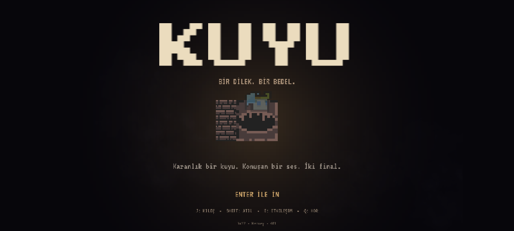
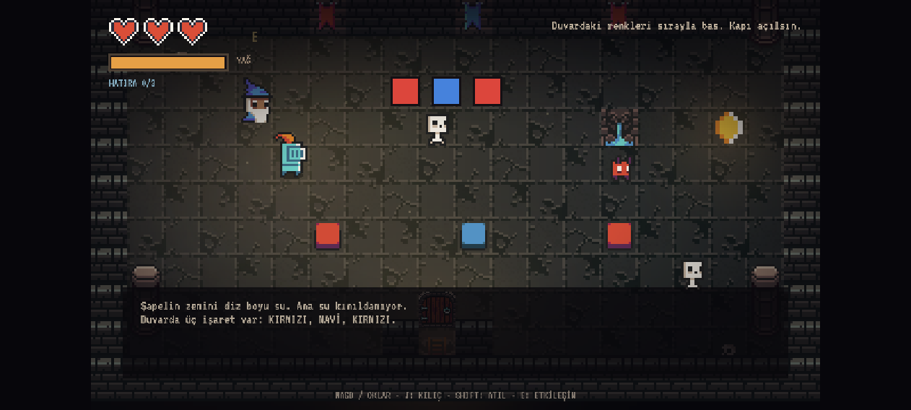

# KUYU

> Bir dilek. Bir bedel.

2.5D görünümlü, top-down piksel korku-aksiyon-macera oyunu. Kız kardeşini kurtarmak için dilek kuyusuna inen bir karakterin hikâyesi. Kuyu konuşur, hatıraları toplar ve sonunda bir seçim bırakır.

**Motor:** KAPLAY 3001.0.19 (dahili fizik, başka motor/fizik kütüphanesi yok)  
**Çalıştırma:** `npm install` → `npm run dev` → `http://localhost:3001`

## Kontroller

| Tuş | İşlev |
|---|---|
| WASD / Ok tuşları | 8 yönlü hareket |
| J / X | Kılıç saldırısı (kombo) |
| Shift / K | Atılma (kısa i-frame + afterimage) |
| E / Enter | Etkileşim, diyalog ilerletme, sandık açma, sandık itme |
| Q | Kor patlaması (tüccardan veya Sessiz Ateş’teki kordan alınır; düşmanları sersemletir) |
| Esc | Duraklat / devam et |
| 1 / 2 | Final seçimi |
| R (game over) | Son odadan devam et |
| Enter (game over) | Baştan başla |

## Numaralı mekanik listesi

1. 8 yönlü hareket ve kamera sabit 3/4 top-down görünüm.
2. 3 vuruşluk kılıç kombosu: ilk iki vuruş dar, üçüncü vuruş geniş alan + 2 hasar + ekran sarsıntısı.
3. Hit-stop: her isabetten sonra 30–45 ms donma; vuruş hissi.
4. Dash: 0.18 sn atılma, 0.32 sn dokunulmazlık, afterimage efekti, 0.9 sn bekleme.
5. Fener yağı: sürekli azalan ışık kaynağı; yağ azaldıkça vinyet koyulaşır, ışık küçülür.
6. Kor patlaması (Q): çevredeki düşmanlara hasar + 1.5 sn sersemletme; yağ tüketir.
7. Etkileşim sistemi: NPC diyalogları, sandık açma, sandık itme, çıkış, E/Q ipucu.
8. Renk sırası bulmacası: KIRMIZI → MAVİ → KIRMIZI plakalara sırayla bas; yanlış sıra sıfırlar.
9. Sandık/sokoban bulmacası: sandığı mavi baskı taşına it; kapı açılır.
10. Zamanlı kapı parkuru: taşa bas, 5 saniyelik kapı açılırken dikenli köprüyü geç.
11. Diken tuzakları: aktif/pasif döngüsü, temas hasarı.
12. Kor/brazier bulmacası: üç ocağı Q ile yak; üçüncü ateş mini-boss’u uyandırır.
13. Chort: mesafeyi koruyan, oyuncuya yavaş bomba atan ranged düşman.
14. Mini-boss: Big Zombie; brazier bulmacasını bitirince doğar, ölünce kapı açılır.
15. Hatıra toplama: 3 gizli hatıra; HUD sayacı ve 3. hatırada finalde gizli epilog.
16. Boss: 2 faz, hücum telegraphı, yarı canda imp çağırma + 8 yönlü bomba halkası.
17. Hayalet apparition: rastgele aralıklarla ekrana giren, yavaşça yükselip kaybolan yarı saydam figür.
18. İki final: “Kopyayı al” ve “Kuyuyu kır”; 3 hatıra ile gizli epilog.
19. Duraklatma, game over, odadan devam, baştan başlama.
20. Oda geçişlerinde fade-in/fade-out; sabit kamera açısı korunur.
21. Ölüm izi: öldüğün yerde kuyuda bir hayalet kalır; sonraki denemede hafif ışık verir.

## Bölümler

| # | Bölüm | İçerik |
|---|---|---|
| I | Kuyu Başı | Öğretici oda, goblinler, sandık, ilk hayalet |
| II | Boğulmuş Şapel | Renk sırası bulmacası, rahip NPC, iskelet/imp, hatıra |
| III | Kemik Pazarı | Sandık bulmacası, tüccar NPC, ork/imp, hatıra |
| IV | Kırık Köprü | Zamanlı kapı, diken parkuru, imp |
| V | Sessiz Ateş | 3 brazier + kor bulmacası, chort, big zombie mini-boss, hatıra |
| VI | Dip | Boss (2 faz) ve final seçimi |

## Düşmanlar

- **Goblin** — hızlı takip, 2 HP.
- **İskelet** — yavaş takip, kısa hücum, 3 HP.
- **Imp** — düzensiz/sinüs hareket, 1 HP.
- **Ork** — ağır, telegraphlı hücum, 5 HP.
- **Chort** — mesafe korur, yavaş bomba atar, 4 HP.
- **Big Zombie** — mini-boss, 10 HP, yavaş ama ağır.
- **Bekçi (Big Demon)** — boss, 18 HP, 2 faz, imp çağırma + bomba halkası.

## UI

Can kalpleri, yağ barı, hatıra sayacı, kombo sayacı, hedef metni, E/Q etkileşim ipucu, diyalog kutusu, boss can barı + “BEKÇİ” etiketi, duraklatma menüsü, final seçim menüsü, başlık ekranı, game over ve iki final ekranı.

## Ses

11 Kenney SFX (swing, hit, hurt, step, break, pickup, open, ghost, select, talk, roar) + 2 Kenney jingle (title, ending) + üretilmiş 12 sn’lik ambiyans drone’u (`assets/ambient/drone.wav`) + düşük canda kalp atışı. Sesler oyun içinde tetiklenir.

## 2.5D / görsel yaklaşım

- 0x72’nin 3/4 perspektifli 16×16 seti; karakterler 16×28.
- Duvarlar 16×32 yüksekliğinde iki parçalı çizilir; `z = y` sıralaması ile karakterlerin duvar arkasında kalması sağlanır.
- Karakter gölgeleri, zemin grime katmanı, üst gölge, vinyet, fener halo ve parçacıklar sabit kamera açısını bozmadan derinlik hissi verir.
- Kamera açısı sabittir; zoom 2×, oda 20×11 tile (320×176 dünya pikseli).

## Puan listesi (jüri için)

### Mekanik (+3)
1. 8 yönlü hareket
2. 3 vuruşluk kılıç kombosu + finisher
3. Hit-stop
4. Dash + i-frame + afterimage
5. Fener yağı / dinamik karanlık
6. Kor patlaması (AoE stun)
7. NPC diyalog sistemi + etkileşim ipucu
8. Renk sırası bulmacası
9. Sandık itme bulmacası
10. Zamanlı kapı parkuru
11. Diken tuzağı döngüsü
12. Brazier/kor bulmacası
13. Chort ranged saldırısı / bomba mermileri
14. Big Zombie mini-boss
15. Hatıra toplama + gizli epilog
16. Boss 2 faz + summon + bomba halkası
17. Hayalet apparition
18. İki final seçimi
19. Duraklatma / game over / devam
20. Fade geçişleri
21. Ölüm izi hayaleti (kalıcı konum + ışık)

### Animasyonlu karakter / düşman (+2)
Hero (knight), kız kardeş (elf), rahip (wizard), tüccar (dwarf), hayalet (angel), goblin, iskelet, imp, ork, chort, big zombie, bekçi (demon) — 12 tip.

### Animasyon durumları (+1)
idle, run, hit: hero/kız kardeş/rahip/tüccar (4×3); idle, run: hayalet/goblin/iskelet/imp/ork/chort/big zombie/demon (8×2) = 28 durum.

### Level (+2)
6 oynanabilir bölüm (Kuyu Başı, Boğulmuş Şapel, Kemik Pazarı, Kırık Köprü, Sessiz Ateş, Dip).

### Juice (+1)
Ekran sarsıntısı, hit-stop, hasar flashı, parçacık patlamaları, tween’ler, dash afterimage, fener/brazier titreşimi, sis ve toz katmanları, ölüm parçacıkları, fade geçişleri.

### UI (+1)
Can kalpleri, yağ barı, hatıra sayacı, kombo, hedef, E/Q ipucu, diyalog, boss barı + etiket, duraklatma, final seçimi, başlık, game over, final ekranları.

### Ses (+1 / 2 efekt)
11 tetiklenen SFX (+5), 2 jingle (+2), üretilmiş ambiyans drone (+2), düşük can kalp atışı.

### Parallax
Bu sürümde klasik parallax katmanı yok; derinlik yüksek duvar, gölge ve ışık katmanlarıyla veriliyor.

## Assetler ve lisanslar

- **0x72 DungeonTileset II v1.7** — CC0 — https://0x72.itch.io/dungeontileset-ii
- **Kenney Tiny Dungeon** — CC0 — https://kenney.nl/assets/tiny-dungeon
- **Kenney Particle Pack** (flame/smoke/spark) — CC0 — https://kenney.nl/assets/particle-pack
- **Kenney Interface Sounds / Impact Sounds / Music Jingles** — CC0 — https://kenney.nl
- **Press Start 2P** — SIL Open Font License 1.1 — https://github.com/google/fonts/tree/main/ofl/pressstart2p
- **VT323** — SIL Open Font License 1.1 — https://github.com/google/fonts/tree/main/ofl/vt323

Lisans dosyaları: `public/assets/licenses/`.

Ambiyans drone’u (`public/assets/ambient/drone.wav`) bu proje için `tools/make-ambient.mjs` ile üretildi; üçüncü taraf kayıt değildir.

## Notlar

- Oyun tek `npm run dev` ile açılır.
- Tüm level’lar kod/ASCII harita ile yazıldı; Tiled/Unity/Godot kullanılmadı.
- Fizik yalnızca KAPLAY’in dahili `body`/`area` sistemi.
- Asset üretim/derleme yardımcısı `tools/build-assets.mjs` yalnızca geliştirme zamanında çalışır (`pngjs` dev dependency).
