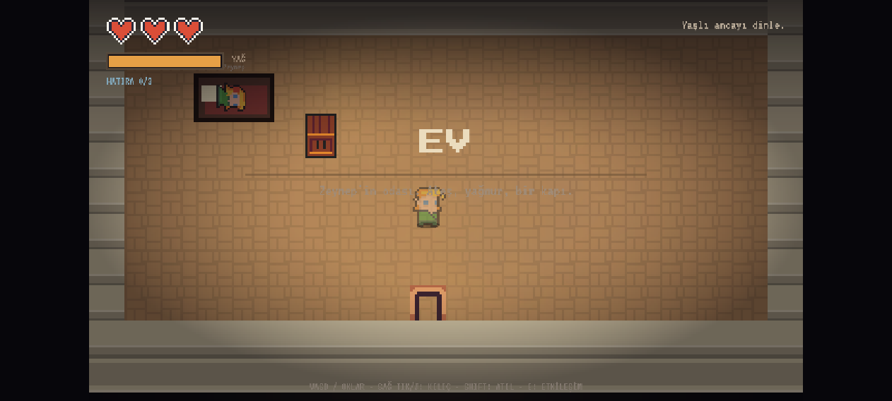
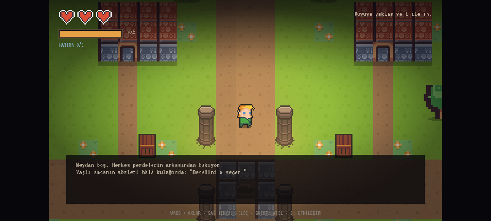
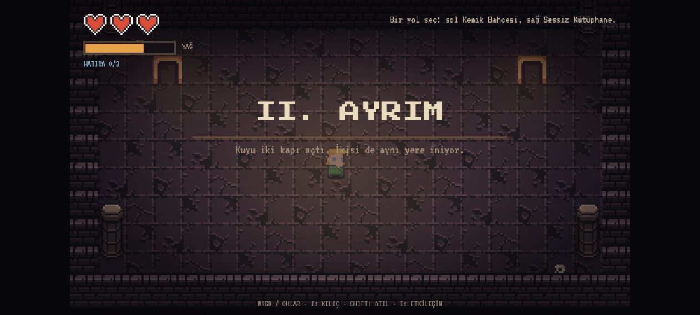
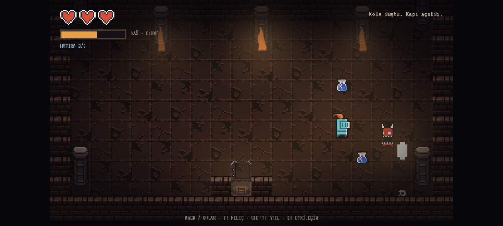
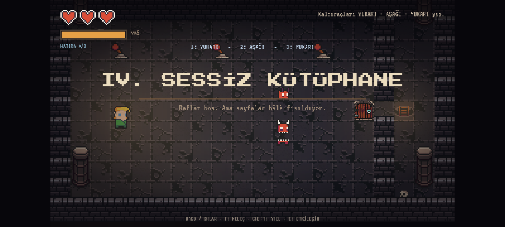
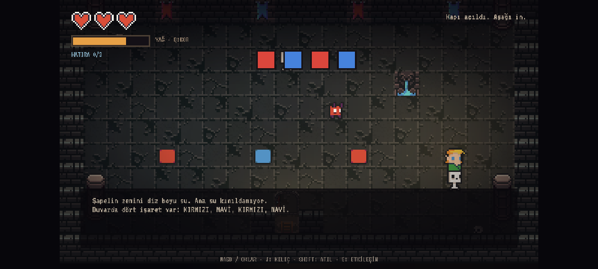

# KUYU

> Bir dilek. Bir bedel.

2.5D görünümlü, top-down piksel korku-aksiyon-macera oyunu. Evinde hasta kız kardeşi Zeynep'in başında bekleyen genç bir maceracı, yaşlı bir amcanın anlattığı lanetli kuyuya iner. Kuyu konuşur, hatıraları toplar ve sonunda bir seçim bırakır. Kasaba, ev, iki yol ayrımı ve dokuz kuyu katı; toplam 11 oynanabilir alan.

**Oyna (Surge):** https://kuyu-game.surge.sh  
**Oyna (GitHub Pages):** https://ronikai.github.io/kuyu/  
**Kaynak:** https://github.com/ronikai/kuyu  
**Motor:** KAPLAY 3001.0.19 (dahili fizik, başka motor/fizik kütüphanesi yok)  
**Çalıştırma:** `npm install` → `npm run dev` → `http://localhost:3001`

## Kontroller

| Tuş | İşlev |
|---|---|
| WASD / Ok tuşları | 8 yönlü hareket |
| Sağ tık / J / X | Kılıç saldırısı (kombo) |
| Shift / K | Atılma (kısa i-frame + afterimage) |
| E / Enter | Etkileşim, diyalog ilerletme, sandık açma, sandık itme |
| Q | Kor patlaması (tüccardan veya Sessiz Ateş’teki kordan alınır; düşmanları sersemletir) |
| Esc | Duraklat / devam et |
| 1 / 2 | Final seçimi |
| R (game over) | Son odadan devam et |
| Enter (game over) | Baştan başla |

## Numaralı mekanik listesi

1. 8 yönlü hareket ve kamera sabit 3/4 top-down görünüm.
2. Sağ tık (veya J/X) ile 3 vuruşluk kılıç kombosu: üçüncü vuruş geniş alan + 2 hasar + ekran sarsıntısı.
3. Hit-stop: her isabetten sonra 30–45 ms donma; vuruş hissi.
4. Dash: 0.18 sn atılma, 0.32 sn dokunulmazlık, afterimage efekti, 0.9 sn bekleme.
5. Fener yağı: sürekli azalan ışık kaynağı; yağ azaldıkça vinyet koyulaşır, ışık küçülür.
6. Kor patlaması (Q): çevredeki düşmanlara hasar + 1.5 sn sersemletme; yağ tüketir.
7. Ev/kuyu giriş sekansı: Zeynep yatakta; yaşlı amca gelir, kuyuyu ve bedelleri anlatır.
8. Kuyu diyaloğu: kasaba meydanında kuyu oyuncuyla konuşur, sonra iniş başlar.
9. İki yol seçimi: Kemik Bahçesi (arena) veya Sessiz Kütüphane (bulmaca); seçim kalıcıdır.
10. Renk sırası bulmacası: KIRMIZI-MAVİ-KIRMIZI-MAVİ; 4 plaka, yanlış sıra baştan başlatır.
11. İki sandık/sokoban bulmacası: iki sandığı iki mavi taşa it; ikisi de basılı kalmalı.
12. Zamanlı kapı parkuru: taşa bas, 5 saniyelik kapı açılırken dikenli köprüyü geç.
13. Çöken köprü taşları: basınca kısa süre sonra düşer, oyuncuyu başlangıca atar.
14. Diken tuzakları: aktif/pasif döngüsü, temas hasarı.
15. Dört brazier/kor bulmacası: dört ocağı Q ile yak; dördüncü ateş mini-boss’u uyandırır.
16. Kaldıraç bulmacası: YUKARI-AŞAĞI-YUKARI deseni; yanlış desende kapı kapalı kalır.
17. Arena modu: tüm bekçiler yenilince mühür açılır ve can ödülü verilir.
18. Chort: mesafeyi koruyan, oyuncuya yavaş bomba atan ranged düşman.
19. Mini-boss: Big Zombie; brazier bulmacasını bitirince doğar, ölünce kapı açılır.
20. Hatıra toplama: 3 gizli hatıra; HUD sayacı ve 3. hatırada finalde gizli epilog.
21. Boss: 2 faz, hücum telegraphı, yarı canda imp çağırma + 8 yönlü bomba halkası.
22. Tam ekran hayalet: sadece kuyuya inince, rastgele aralıklarla tüm ekranı kaplayan, ses efektiyle beliren yarı saydam figür.
23. Ölüm izi: öldüğün yerde kuyuda bir hayalet kalır; sonraki denemede hafif ışık verir.
24. İki final: “Kopyayı al” ve “Kuyuyu kır”; 3 hatıra ile gizli epilog.
25. Duraklatma, game over, odadan devam, baştan başlama.
26. Oda geçişlerinde fade-in/fade-out; sabit kamera açısı korunur.

## Bölümler

| # | Bölüm | İçerik |
|---|---|---|
| 0 | Ev | Zeynep yatakta, yaşlı amca, hikâye girişi |
| 1 | Kasaba Meydanı | Kuyu, evler, ağaçlar, ilk iniş |
| 2 | I. Kuyu Başı | Öğretici oda, goblinler, sandık, ilk hayalet |
| 3 | II. Ayrım | İki yol seçimi: arena veya kütüphane |
| 4 | III. Kemik Bahçesi | Arena dalgası, ork/imp/chort/iskelet, can ödülü |
| 5 | IV. Sessiz Kütüphane | Kaldıraç bulmacası, chort/imp, kor ödülü |
| 6 | V. Boğulmuş Şapel | 4 renk sırası, iskelet/imp, hatıra |
| 7 | VI. Kemik Pazarı | İki sandık bulmacası, ork/imp, hatıra |
| 8 | VII. Kırık Köprü | Zamanlı kapı, diken + çöken taş parkuru |
| 9 | VIII. Sessiz Ateş | 4 brazier, chort, big zombie mini-boss, hatıra |
| 10 | IX. Dip | Boss (2 faz) ve final seçimi |

Kuyu içinde oyuncuyla konuşan NPC yoktur; anlatım kuyunun sesi, hatıra metinleri ve çevre ile verilir.

## Düşmanlar

- **Goblin** — hızlı takip, 2 HP.
- **İskelet** — yavaş takip, kısa hücum, 3 HP.
- **Imp** — düzensiz/sinüs hareket, 1 HP.
- **Ork** — ağır, telegraphlı hücum, 5 HP.
- **Chort** — mesafe korur, yavaş bomba atar, 4 HP.
- **Big Zombie** — mini-boss, 10 HP, yavaş ama ağır.
- **Bekçi (Big Demon)** — boss, 18 HP, 2 faz, imp çağırma + bomba halkası.

## UI

Can kalpleri, yağ barı, hatıra sayacı, kombo sayacı, hedef metni, E/Q etkileşim ipucu, diyalog kutusu, boss can barı + “BEKÇİ” etiketi, duraklatma menüsü, final seçim menüsü, ev girişi, game over ve iki final ekranı.

## Ses

11 Kenney SFX (swing, hit, hurt, step, break, pickup, open, ghost, select, talk, roar) + 2 Kenney jingle (title, ending) + üretilmiş 12 sn’lik ambiyans drone’u (`assets/ambient/drone.wav`) + düşük canda kalp atışı. Sesler oyun içinde tetiklenir.

## 2.5D / görsel yaklaşım

- 0x72’nin 3/4 perspektifli 16×16 seti; karakterler 16×28.
- Duvarlar 16×32 yüksekliğinde iki parçalı çizilir; `z = y` sıralaması ile karakterlerin duvar arkasında kalması sağlanır.
- Karakter gölgeleri, zemin grime katmanı, üst gölge, vinyet, fener halo ve parçacıklar sabit kamera açısını bozmadan derinlik hissi verir.
- Kamera açısı sabittir; zoom 2×, normal odalar 20×11 tile (320×176 dünya pikseli).
- Kasaba 40×24 tile: ön-render zemin + canlı ağaçlar, kamera oyuncuyu takip eder; diğer odalarda kamera sabittir.
- Kasaba zemini tek PNG olarak ön-render edilir; bu sayede büyük harita 60 FPS’e yakın çalışır.

## Puan listesi (jüri için)

### Mekanik (+3)
1. 8 yönlü hareket
2. Sağ tık kılıç + 3 vuruşluk kombo finisher
3. Hit-stop
4. Dash + i-frame + afterimage
5. Fener yağı / dinamik karanlık
6. Kor patlaması (AoE stun)
7. Etkileşim sistemi: diyalog, sandık, sandık itme, kaldıraç, çıkış
8. Ev/kuyu giriş sekansı (Zeynep + yaşlı amca)
9. Kasaba kuyusu diyaloğu
10. İki yol seçimi (arena / kütüphane)
11. 4 adımlı renk sırası bulmacası
12. İki sandıklı sokoban bulmacası
13. Zamanlı kapı parkuru
14. Çöken köprü taşları
15. Diken tuzağı döngüsü
16. 4 brazier/kor bulmacası
17. Kaldıraç deseni bulmacası
18. Arena dalgası / mühür
19. Chort ranged saldırısı / bomba mermileri
20. Big Zombie mini-boss
21. Hatıra toplama + gizli epilog
22. Boss 2 faz + summon + bomba halkası
23. Tam ekran hayalet (sadece kuyuda, sesli)
24. Ölüm izi hayaleti
25. İki final seçimi
26. Duraklatma / game over / devam / fade geçişleri

### Animasyonlu karakter / düşman (+2)
Genç maceracı (elf), kız kardeş (elf), yaşlı amca (wizard), hayalet (angel), goblin, iskelet, imp, ork, chort, big zombie, bekçi (demon) — 11 tip.

### Animasyon durumları (+1)
idle, run, hit: maceracı/kız kardeş/yaşlı amca (3×3); idle, run: hayalet/goblin/iskelet/imp/ork/chort/big zombie/demon (8×2) = 25 durum.

### Level (+2)
11 oynanabilir alan (Ev, Kasaba, Kuyu Başı, Ayrım, Kemik Bahçesi, Sessiz Kütüphane, Boğulmuş Şapel, Kemik Pazarı, Kırık Köprü, Sessiz Ateş, Dip).

### Juice (+1)
Ekran sarsıntısı, hit-stop, hasar flashı, parçacık patlamaları, tween’ler, dash afterimage, fener/brazier titreşimi, sis ve toz katmanları, ölüm parçacıkları, fade geçişleri.

### UI (+1)
Can kalpleri, yağ barı, hatıra sayacı, kombo, hedef, E/Q ipucu, diyalog, boss barı + etiket, duraklatma, final seçimi, ev girişi, game over, final ekranları.

### Ses (+1 / 2 efekt)
11 tetiklenen SFX (+5), 2 jingle (+2), üretilmiş ambiyans drone (+2), düşük can kalp atışı.

### Parallax
Bu sürümde klasik parallax katmanı yok; derinlik yüksek duvar, gölge ve ışık katmanlarıyla veriliyor.

## Assetler ve lisanslar

- **0x72 DungeonTileset II v1.7** — CC0 — https://0x72.itch.io/dungeontileset-ii
- **Kenney Tiny Dungeon** — CC0 — https://kenney.nl/assets/tiny-dungeon
- **Kenney Tiny Town** — CC0 — https://kenney.nl/assets/tiny-town
- **Kenney Roguelike/RPG Pack** — CC0 — https://kenney.nl/assets/roguelike-rpg-pack
- **Kenney Particle Pack** (flame/smoke/spark) — CC0 — https://kenney.nl/assets/particle-pack
- **Kenney Interface Sounds / Impact Sounds / Music Jingles** — CC0 — https://kenney.nl
- **Press Start 2P** — SIL Open Font License 1.1 — https://github.com/google/fonts/tree/main/ofl/pressstart2p
- **VT323** — SIL Open Font License 1.1 — https://github.com/google/fonts/tree/main/ofl/vt323

Lisans dosyaları: `public/assets/licenses/`.

Ambiyans drone’u (`public/assets/ambient/drone.wav`) bu proje için `tools/make-ambient.mjs` ile üretildi; üçüncü taraf kayıt değildir.

## Notlar

- Oyun tek `npm run dev` ile açılır.
- Oyun doğrudan evde başlar; siyah ekran/yazı intro’su yoktur.
- Tüm level’lar kod/ASCII harita ile yazıldı; Tiled/Unity/Godot kullanılmadı.
- Fizik yalnızca KAPLAY’in dahili `body`/`area` sistemi.
- Asset üretim/derleme yardımcısı `tools/build-assets.mjs` yalnızca geliştirme zamanında çalışır (`pngjs` dev dependency).
